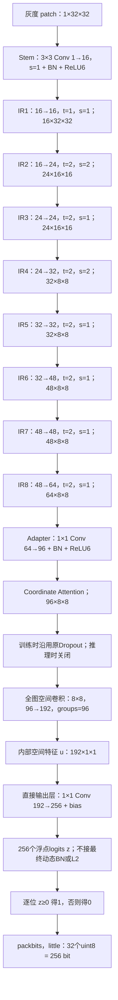
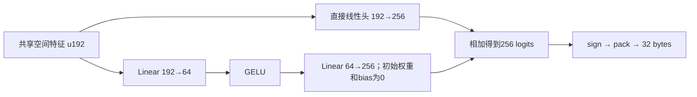
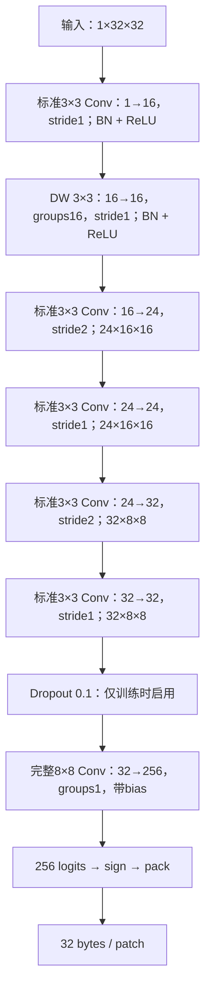
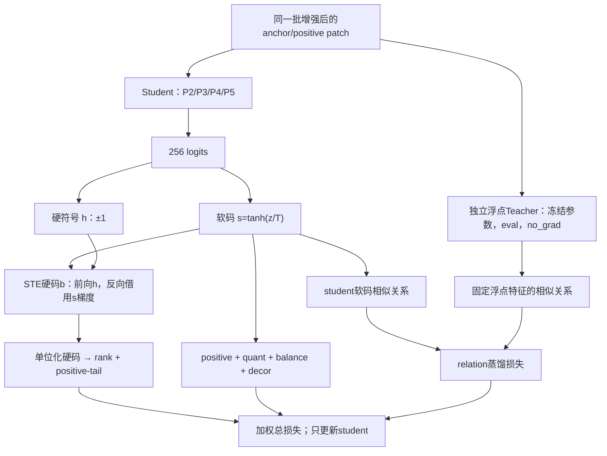

# 256-bit 直接二值描述子模型设计

首次设计：2026-10-25；多方案扩展：2026-10-26；P9及P7-L实现：2026-10-27。模型范围为单patch约80 MFLOPs、FP32参数约10 MB以内，**最新取舍见4.6节**。P9与P7-L已实现训练配置、融合初始化、固定教师、头适配/联合阶段、续训及Torch/ORT加载，完成小步验证，尚未启动正式长训练。其他新骨干仍是待实现候选。启动步骤和训练优化对照见[训练README的P9/P7-L章节](hardnet_train/README.md)；P7-L须先用[浮点配置](hardnet_train/config_p7_l_256.yaml)预训练，再用[直接二值配置](hardnet_train/config_binary_p7_l_direct_256.yaml)联合微调。

此前“计算量严格低于m1”的要求促成P6/P7/P8，现已被约80 MFLOPs的新范围替代。它们仍是轻量对照，但新预算下不再因某方案MAC略高于m1就排除。所有候选仍输出256 bit，精度按相同FAR比较身份级FRR。

4.5节记录旧的低于m1预算下的精简建议；**当前实验优先级以4.6节为准**。本轮更新实验计划和统计口径，不删除模型代码、权重或历史记录，也不将结构预算通过当作运行时间和RSS已达标。

## 1. 设计结论

当前建议以 **m0直接256头联合微调（P9）** 和 **P7-L/P7-M中等宽度普通CNN** 为主要实验，P6与m1系列提供轻量对照。原先的MobileBinary256（P2）和低于m1预算下的P6仍保留设计依据；固定Hadamard融合初始化、二值联合训练、可选固定教师的方法可迁移到不同主干，部署只保留student并输出 `[N,32] uint8`。

同时必须优化完整匹配路径。本次补测中，现有 m1 + Hadamard256 的完整识别平均 **169.99 ms**，其中 40 模板匹配平均 **125.41 ms**。即使 CNN 耗时降为零，当前匹配部分仍超过 100 ms。因此，“设计更小的网络”不能单独解决要求。

主线优先保留特征容量、优化候选生成，不减少约 400 个关键点或 40 张模板，也不以放宽识别阈值换速度。新模型精度与整段达标均需后续实验；当前不能保证它优于所有候选。

### 1.1 新方案与此前两条路线的区别

| 方面 | 已有浮点模型 + Hadamard256 | 已有学习式二值路线 | 新直接头主线（P2） |
|---|---|---|---|
| 特征结构 | m1 → 浮点256维 → 固定 H256 → sign | 浮点主干 → 独立 ResidualHashHead → sign | m1 空间特征192维 → 单层256 logits → sign |
| 训练目标 | 浮点描述子距离；二值化作为后处理 | 默认冻结主干，训练较复杂的二值头 | 先适配头，再让主干与头共同优化硬二值码 |
| 默认码长 | 本对照256 bit | 当前二值 YAML 默认512 bit；结构也支持256 | 所有新候选统一256 bit |
| 教师 | 无独立二值蒸馏阶段 | 当前 teacher 来自同一个 backbone，解冻后会变化 | 独立固定的浮点教师，仅训练时使用 |
| 推理执行 | ORT 跑CNN，外部执行Hadamard和打包 | 当前ORT路径只导出backbone，hash head仍由PyTorch执行 | 计划把整个student到logits导出为一个ORT图，再sign和打包 |
| 主要改变 | 已有性能/精度基线 | 增加编码映射能力 | 保留空间特征容量，减少头部开销，针对量化适配主干 |

这里以实测 m1 为比较基线，不表示匹配 YAML 已切换到 m1。此前的默认训练和匹配配置保持不变。

**仅做 Hadamard/BN 融合不会凭空提高精度。** 融合负责继承基线和简化部署；精度变化来自后续二值目标训练、教师约束、非线性容量及数据质量。固定可逆的 H 本身不增加线性映射的表达能力；当两侧具有相同的可训练仿射自由度（包括bias或等价的BN affine）时，可以将它吸收到输出层。当前新头还允许bias更新，而旧无bias卷积加固定、无affine的最终BN，其末端偏置固定；这一自由度变化应与“融合本身”区分。

## 2. 已确认的验收边界

- 本机 AMD Ryzen 9 5900HX，Windows，CPU；当前部署基线为 FP32 ONNX Runtime。
- 一张内存中的灰度图，约 400 个有效关键点，输出 256-bit packed 描述子。
- 最新结构范围：单patch约80 MFLOPs以内（1 MAC=2 FLOPs），FP32参数净大小约10 MB以内；取消“MAC必须低于m1”。具体值、边界例外与统计遗漏均需报告。
- 完整 1:1 指定身份验证，40 张注册模板常驻；**整段算术平均耗时 < 100 ms**，取代旧的描述子生成 p95 < 70 ms。
- 从图像开始，到检测、裁剪、标准化、描述子、匹配、RANSAC、纹理验证、身份融合及判定结束，**预热后单请求峰值 ΔRSS < 30,000,000 bytes**。
- 30 MB 是相对完整路径预热后空闲基线的增量，不是进程总 RSS。模型、运行时与模板的常驻成本另报；冷启动扩容也另报。
- 精度：比较最终身份级相同 FAR 下的 FRR，不固定 FAR 数值，不预设允许回退。

完整定义见[模型性能约束](模型性能约束.md)。主性能对照固定全部 40 模板；接受、拒绝和重计算分支分别报告，避免靠有利样本比例满足均值。

### 2.1 ORT 是什么

**ORT 是 ONNX Runtime 的缩写，是执行模型的推理引擎。** 本项目用 PyTorch 定义和训练网络，导出 ONNX 格式的计算图后，由 ORT 的 CPU 后端执行。ONNX 是模型交换格式，ORT 是运行该图的软件，FP32 是数值精度，Hadamard / sign 是算法步骤；它们分别回答不同问题。[官方说明](https://onnxruntime.ai/docs/)

```text
训练：patch → PyTorch student → 损失 → 反向传播更新权重
部署：导出student为ONNX → ORT加载 → patch前向得到logits → sign和打包
```

文中的“ORT 8/1”表示 `intra_op_num_threads=8`、`inter_op_num_threads=1`：前者控制单个算子内部的并行，后者控制图中算子之间的并行线程设置。当前后端未显式启用图并行，使用默认 sequential 执行；inter-op 线程池只有在 parallel 模式才创建。不能把 8/1 理解成模型有 8 层、一次处理 8 张图，或整个进程只有 9 个线程。[官方线程说明](https://onnxruntime.ai/docs/performance/tune-performance/threading.html)

ORT 可以做图优化和使用优化算子，但不是“自动二值化器”，也不保证任何模型都更快。新方案计划减少 ORT 与 PyTorch 之间的混合调用；是否更快仍以完整请求实测为准。

## 3. 新补测：瓶颈首先在匹配

2026-10-25，使用已训练 m1 + Hadamard256、ORT 8/1 线程、batch 64、OpenCV 1 线程、PyTorch 后处理 1 线程。5 次完整预热，20 次实际墙钟测量，不启用 RSS 采样线程；每次均完成 40 张模板匹配。

3 张非本人查询图循环，对指定 `crp_L0` 身份验证，实际描述子数为 394 / 391 / 389。mask、quality 与质量适配关闭，纹理验证按原条件触发。该小样本用于定位瓶颈，不代表正式精度或全输入验收。

| 指标 | 本次观测均值（ms） | 说明 |
|---|---:|---|
| SIFT 检测与截断 | 3.48 | 未计算 SIFT 描述子 |
| 裁剪与标准化 | 12.85 | 现有实现 |
| 描述子与后处理 | 27.51 | CNN、Hadamard、打包等 |
| 特征生成合计 | 43.84 | 上述三项之和 |
| 特征生成及查询模板组装 | 44.57 | 计入新请求时间 |
| 40 模板匹配墙钟 | 125.41 | 含准备、候选、几何、纹理、融合及开销 |
| **完整请求墙钟** | **169.99** | **未达到平均 < 100 ms** |
| 候选生成 | 98.39 | 已包含在匹配时间内，不再相加 |
| RANSAC | 15.37 | 已包含在匹配时间内 |
| 纹理验证 | 1.35 | 只有部分模板触发，不能当重分支上界 |

完整请求 p95 为 174.90 ms。不得采用扣除准备 / 杂项后的 `core_ms` 代替墙钟验收。

第二轮相同范围的函数包裹剖析中，候选生成均值约 98.57 ms，其中 `hamming_bidirectional_knn` 约 70.54 ms，剩余约 28.03 ms 包括契约、配置解析、逐点筛选和候选构造。前者含内部校验与数组处理，不能称为纯 POPCNT 内核时间。当前配置实际只需要正向 top-2，并未运行双向 ratio；所以“复用双向矩阵”不是当前主要收益点。

追加线程可行性实验保持特征阶段 OpenCV=1，只将匹配阶段设为 4 或 8 线程。各 3 次完整预热、10 次墙钟测量，线程设置开销也计入：

| 匹配 OpenCV 线程 | 特征与查询组装均值 | 匹配均值 | 完整均值 | 完整 p95 |
|---|---:|---:|---:|---:|
| 4 | 49.26 ms | 97.11 ms | 146.36 ms | 155.93 ms |
| 8 | 44.98 ms | 82.98 ms | 127.96 ms | 131.61 ms |

8 线程的候选生成降至 53.23 ms，但整段仍未达到 100 ms。两组各 10 条记录与 1 线程的对应查询比较，点数、实际模板调用数、最终分数和分支计数没有差异；这不是全候选等价测试或完整精度评估。本次没有重测 RSS，不能据此认证 8 线程满足内存预算。

证据：[4 线程 JSON](C:/Users/ZYH/.codex/visualizations/2026/10/20/01a1580a-f115-79a1-bfe1-df2150319e5a/full_recognition_phase_cv4_20261025.json)、[8 线程 JSON](C:/Users/ZYH/.codex/visualizations/2026/10/20/01a1580a-f115-79a1-bfe1-df2150319e5a/full_recognition_phase_cv8_20261025.json)、[线程实验脚本](C:/Users/ZYH/.codex/visualizations/2026/10/20/01a1580a-f115-79a1-bfe1-df2150319e5a/full_recognition_threads_probe_20261025.py)。上述小样本、未随机交错的实验只支持实现方向，不将不同轮次的差值当成稳定加速承诺。

证据：[完整识别 JSON](C:/Users/ZYH/.codex/visualizations/2026/10/20/01a1580a-f115-79a1-bfe1-df2150319e5a/full_recognition_budget_20261025.json)、[补测脚本](C:/Users/ZYH/.codex/visualizations/2026/10/20/01a1580a-f115-79a1-bfe1-df2150319e5a/full_recognition_budget_20261025.py)。JSON 保存合并后的配置、版本与 SHA-256；当前配置和运行状态与 10 月 20 日不同，不能将本次 43.84 ms 与旧 58.61 ms 的差值宣称为优化收益。

## 4. 网络结构：保留空间信息，直接输出 256 个 logits

输入仍是现有标准化的 `1×32×32` 灰度 patch，保持检测、方向对齐和 patch 数据契约。

下图为 P1 / P2 的完整部署结构，尺寸均为单 patch 的“通道×高×宽”。P1 和 P2 的网络相同，只有训练时是否加入固定教师不同。



IR 的 `t` 是通道扩展倍率，`s` 是步幅。内部先做通道扩展、逐通道空间卷积、线性投影；尺寸和通道相同时使用残差相加。192 是内部空间特征宽度，不是最终 bit 数；256 logits 中每个值决定一个 bit。

| 阶段 | 结构 | 单 patch 输出 |
|---|---|---|
| Stem | 3×3 Conv，1→16，stride 1，BN，ReLU6 | 16×32×32 |
| IR 1 | 16→16，expansion 1，stride 1 | 16×32×32 |
| IR 2–3 | 16→24 / 24→24，expansion 2，stride 2 / 1 | 24×16×16 |
| IR 4–5 | 24→32 / 32→32，expansion 2，stride 2 / 1 | 32×8×8 |
| IR 6–8 | 32→48 / 48→48 / 48→64，expansion 2，stride 1 | 64×8×8 |
| Adapter + 注意力 | 1×1 Conv 64→96，BN，ReLU6，现有 Coordinate Attention | 96×8×8 |
| 空间聚合 | 8×8 grouped Conv，96→192，groups=96 | 192×1×1 |
| **直接二值输出头** | **1×1 Conv，192→256，带 bias，不接动态 BN** | **256 logits** |
| 量化与打包 | `logits >= 0`，little bitorder | **32 bytes** |

IR 沿用现有倒残差模块。保留浅层分辨率与可学习的全 patch 空间聚合，避免先大幅下采样或用全局均值替换空间布局。这样的选择是保精度的设计倾向，不是已有消融结论。

最终 256 个值直接用于 sign，训练时是浮点 logits，部署后不保存 256 维 FP32 描述子。卷积权重与激活仍是 FP32；“二值描述子”不等于整网使用 1-bit 运算。

### 4.1 计算量与参数

以下按当前模型代码及拟议直接头，在内存中构造并用 Conv/Linear hook 统计。1 MAC 约按 2 FLOPs 报告；不含 BN、激活、注意力逐元素运算、sign / pack 及匹配。参数包含尚未融合的其他 BN 参数，不含 buffers 或运行时内存。

| 网络 | 参数量 | MAC / patch | FP32 参数净字节 |
|---|---:|---:|---:|
| 已有 m1 浮点主干 | 112,752 | 5,004,288 | 451,008 |
| m1 + 当前 residual256 头 | 509,040 | 5,397,504 | 2,036,160 |
| m1 + 当前 residual512 头 | 1,560,176 | 6,446,080 | 6,240,704 |
| **MobileBinary256 直接头** | **113,008** | **5,004,288** | **452,032** |
| 备用：删除两个重复 IR 后的直接头 | 99,472 | 3,658,752 | 397,888 |

主方案 400 patch 为 **2.0017152 GMAC**。相对 residual256 参数减少约 77.8%，Conv/Linear MAC 只减少约 7.3%；不能把参数缩小倍率当成推理加速倍率。相对已有 m1 + Hadamard，主干 MAC 基本不变，主要节省外置归一化 / 变换和接口开销。

备用方案仅删除原第 3 和第 7 个 IR（24→24、48→48），保留尺度与后续通道；MAC 下降约 26.9%，但精度未知且最大早期激活未消失。只有主方案的特征阶段成为瓶颈时才优先研究它，不先以容量换未证实的收益。m2 / Strong V2 不重新引入；512-bit 不满足本次固定码长。

### 4.2 用已有 Hadamard 基线初始化直接头

直观理解：把已有模型最后几步的线性运算“预先乘在一起”，保存为新输出层的初始权重。旧流程先算浮点特征、再做固定 Hadamard 变换；新流程启动时用一个层实现等价映射，随后允许这一层和主干继续学习。Hadamard 矩阵不是标签，也不是必须永久保留的后处理。

例如忽略 BN 和偏置时，旧末端是 `u → W·u → H·(W·u)`，可初始化新权重为 `W_binary=H·W`。下面加入真实 BN 和偏置后给出完整公式。

令空间聚合后的 192 维向量为 `u`，已有末端卷积权重为 `W`。最终 BN 在 eval 模式下可写为：

```text
A = diag(gamma / sqrt(running_var + epsilon))
c = beta - A × running_mean
q = A × W × u + c
f = q / max(||q||₂, epsilon)
```

现有末端 BN 默认 `affine=False`，因此 gamma=1、beta=0。由于归一化分母为正，实数运算下 `sign(Hf) = sign(Hq)`。采用正比例归一化的 `Hn = H / 16`，初始化：

```text
W_binary = Hn × A × W
b_binary = Hn × c
z = W_binary × u + b_binary
bits = (z >= 0)
```

这样不增加一层 256→256 哈希网络；部署图不再需要最终 BN、L2 归一化或显式 FWHT。后续直接训练 `W_binary`、`b_binary` 和主干，输出已成为学习式二值描述子，Hadamard 仅用于初始化。

这只是实数代数等价：FP32 的运算顺序、矩阵融合和近零 logits 会造成潜在翻位。必须使用 checkpoint 的 BN running statistics，先以真实 patch 比较逐 bit 差异、最大 logit 误差与接近零的比例，再回归完整识别。不能承诺数值逐位完全相同，也不能在头后重新添加动态 BN 而继续声称初始化等价。

### 4.3 候选结构库（最新实验取舍见4.6节）

这些候选都有明确的结构与实现依据，适合逐一试验；目前没有统计证据可以为“达标概率”赋值。所有方案都依赖同一套完整匹配优化，不能从网络计算量推断整体已经满足 100 ms / 30 MB。

| 编号 | 模型与训练差异 | 参数量 | MAC / patch | 主要价值与风险 |
|---|---|---:|---:|---|
| P0 基线 | 已有 m1 浮点256 → 固定Hadamard → sign | 112,752 | 5,004,288 | 已有权重，建立同条件精度/性能基线；可能有未补偿的量化损失 |
| P1 简洁方案 | 直接256头，Hadamard融合初始化，联合微调，不用教师关系项 | 113,008 | 5,004,288 | 自由适应硬码，训练依赖少；可能遗忘原有浮点结构 |
| **P2 优先主线** | **P1 + 独立固定教师关系蒸馏** | **113,008** | **5,004,288** | **限制小数据下的特征漂移；教师有偏差或约束太强时也可能不如P1** |
| P3 轻量非线性 | P2直接头 + 192→64→256残差分支，固定教师联合训练 | 142,000 | 5,032,960 | 增加非线性编码能力；小幅增加算子与过拟合风险，尚需新实现 |
| P4 资源优先 | 去掉IR3和IR7，直接256头 + 固定教师联合训练 | 99,472 | 3,658,752 | 计算量比P2少约26.9%；空间表征容量下降，精度风险更大 |
| P5 现有头对照 | m1浮点256 + 现有ResidualHashHead256，hidden_multiplier=1.0，联合训练+固定教师 | 377,712 | 5,266,432 | 头结构可复用，表达能力较强；参数/算子更多，无法直接继承Hadamard初始化 |
| **P6 新骨干** | **窄通道普通卷积 + 完整8×8空间头，先浮点预训练再二值联合；优先验证m0教师** | **549,888** | **4,063,232** | **MAC比m1低18.8%；末端空间映射更灵活，但参数增加，精度需实测** |

参数是部署 student 的参数，P2–P6 的教师不计入部署。P1/P2 不需要分别设计两种网络；有无蒸馏是训练消融。P0 还需增加一个“融合后不训练”的工程对照，它只检查转换与运行时，不作为独立精度方案。

**P3 的具体结构与初始化：** 保留 P2 的直接线性路径，增加宽度64的分支：

```text
z_direct = W_binary·u + b_binary
r = V2·GELU(V1·u + a1) + a2
z = z_direct + r

V1: 192→64；V2: 64→256；两层均带bias
V1常规随机初始化，V2和a2置零，使初始r=0
```



新增参数为 `192×64+64+64×256+256=28,992`，新增 MAC 为 `192×64+64×256=28,672`，约为 P2 总 MAC 的0.57%。这不代表实际延迟只增加0.57%，小矩阵和GELU仍有调度成本。非线性分支不能继续全部融合为一个线性层。末层置零能继承 P2 初始输出；不要再同时添加零初始化的乘法门，以免分支梯度被锁住。

**P4：** 复用保留层和输出头的初始权重，但删除块后 `u` 已改变，整个网络不能再声称与原 Hadamard 码等价。先做头适配，再用固定教师联合微调恢复能力；BN统计是否重估单独验证。最大早期激活仍在，不将26.9%的MAC降低等同于RSS降低。

**P5：** 沿用现有 LayerNorm、投影、残差MLP和输出投影；隐藏层取256而非512。LayerNorm含逐样本统计，不能直接按4.2节线性融合继承旧码；应从浮点m1和随机hash head起步，先冻结主干训练头，再联合微调。它是复用现有实现的对照，新增固定教师和完整导出仍需要实现。

首轮优先跑 **P0 → P1/P2 → P3**；再测试 P4、P5。P1/P2回答教师有没有帮助，P2/P3回答非线性头有没有帮助，P2/P4回答更小主干是否值得，P2/P5回答现有复杂头是否有精度回报。所有候选保留结果，最终按实测选择，不因 P2 是主线就预设它获胜。

以上是原方案测试顺序。针对新增的“MAC严格小于m1”要求，**P6作为新骨干优先候选，P4作为较简单的压缩对照**；P0/P1/P2的MAC等于m1，P3/P5高于m1，它们继续提供精度与训练方法对照，不进入这一更严格的新增骨干候选集合。

### 4.4 P6：HybridSpatial256，新骨干与完整空间输出头

#### 4.4.1 先判断现有 m1 是否只是没训练充分

审计 `outputs/models/3/m0/m0_256_v2` 与 `m1/m1_256_v2`：两者都完成100个epoch、记录100,000个训练step，best分别位于epoch4和64。AMP是否跳过个别参数更新没有日志，不能把step数等同于精确的有效更新次数。配置除architecture/output_dir外一致，包括数据路径、seed、增强、优化器和验证设置；但checkpoint没有数据内容SHA或代码commit，不能据此证明完全公平，相同超参数也不一定适合不同架构。

当前float/L2 patch结果中，best m0与m1在 `FPR=10⁻⁴` 时的TPR分别约94.10%和92.59%。m1从epoch64继续到100，验证loss由0.1931降至0.1895，但该TPR反而降到91.19%。这说明需要检查低误报尾部与选模目标，不能仅凭loss下降判断识别更好，也不能保证延长训练就能解决。m1的部分整体patch指标（AUC/EER）优于m0，不把它概括为所有指标都差。

另有历史身份级float256/L2评估，31个身份、40模板，1,865次真实尝试和55,950次冒认尝试：FAR=10⁻⁴时FRR为m0 **1.877%**、m1 **3.485%**；FAR=10⁻³时为1.072%与2.252%。这些是已有工作点的观察，不是新固定的验收FAR目标。两份query及模板标识、顺序和匹配参数对齐，但阈值选取与评估使用同一query池，旧checkpoint路径也没有hash证明对应当前重命名产物。因此它支持研究方向，不能当作当前256-bit模型的独立测试结论。

来源：[m0训练曲线数据](outputs/models/3/m0/m0_256_v2/metrics.csv)、[m1训练曲线数据](outputs/models/3/m1/m1_256_v2/metrics.csv)、[m0历史身份评估](outputs/检查是否有异常手指/m0_256_v2_best.pt-模板数40-数据集normal_pic-31/eval_hardnet_l2/metrics.json)、[m1历史身份评估](outputs/检查是否有异常手指/m1_256_v2_best.pt-模板数40-数据集normal_pic-31/eval_hardnet_l2/metrics.json)。

另需注意现有综合选模分数中的 `0.35×(1−FPR@TPR95)`：当FPR已经很小时，0.0001513变为0.0004301只使该项少约0.0000976分，可能被loss等项的改善覆盖。**这是综合分与低FAR目标不完全一致的机制性风险，不是精度差的唯一原因。** 新实验应额外保存同FAR的身份级FRR结果，不能只按该综合分确定赢家；本轮不修改现有选模实现。

#### 4.4.2 新结构把计算放在哪里

P6保留32×32阶段的16个通道和两次空间滤波，在16×16、8×8阶段使用普通卷积联合学习空间与通道关系；末端采用类似m0的完整8×8空间映射。它不再沿用m1的八个倒残差块、96通道adapter或坐标注意力，也不把空间特征先压成192维。



前六层全部为无bias卷积接BN、ReLU；3×3层padding=1。最后8×8层stride=1、padding=0，不接动态BN或激活，直接输出logits。上述为最终二值student的部署结构；输入继续复用项目既有patch裁剪与逐patch标准化，不同时改变输入分布。

| 层 | 单patch输出 | Conv/Linear MAC |
|---|---|---:|
| 标准3×3，1→16，s1 | 16×32×32 | 147,456 |
| DW 3×3，16→16，s1 | 16×32×32 | 147,456 |
| 标准3×3，16→24，s2 | 24×16×16 | 884,736 |
| 标准3×3，24→24，s1 | 24×16×16 | 1,327,104 |
| 标准3×3，24→32，s2 | 32×8×8 | 442,368 |
| 标准3×3，32→32，s1 | 32×8×8 | 589,824 |
| 完整8×8，32→256 | 256×1×1 | 524,288 |
| **合计** | **256 logits** | **4,063,232** |

使用项目profile工具在内存中构造随机权重原型并实际前向，得到：

- **549,888参数，4,063,232 MAC/patch**；m1为112,752参数、5,004,288 MAC/patch。
- MAC减少 **18.80499%**；400 patch为 **1.6252928 GMAC**。这是统一Conv/Linear口径，不含BN、激活、sign、pack和匹配。
- FP32参数净大小 **2,199,552 B（约2.20 MB）**。参数是m1的约4.88倍，不能称为“参数也更少”；以更便宜的末端容量换取空间表达能力，是这里的取舍。
- 随机权重batch64前向 `[64,256]`、有限数值检查及打包 `[64,32] uint8` 通过；这不是训练、精度、延迟或RSS验收。

#### 4.4.3 为什么有希望改善精度，但不能保证

m1末端的全图DW卷积每个输入通道只产生两个空间响应，再经1×1混合成256维。对固定输入通道c，其有效空间权重矩阵可写为：

```text
K_c[o, s] = P[o, c, 1]·D[c, 1, s] + P[o, c, 2]·D[c, 2, s]
```

因此该 `256输出×64位置` 矩阵的秩至多为2。P6的完整8×8头允许每个输入通道拥有更自由的 `256×64` 空间映射，最高秩可到64。它有机会更好地区分局部脊线的方向、相位与位置组合，且标准卷积可直接学习跨通道的局部空间关系。

**上述是给定输入特征后的线性head限制，不是整个m1网络的秩上界或精度证明。** m1上游的非线性与输入相关注意力仍能学习复杂表示；P6只有32个末端通道，也可能损失有用特征。其较大末端参数还增加过拟合和权重访存风险，必须用数据、正则与完整验证判断是否值得。

#### 4.4.4 P6的训练方法：先学自己的浮点特征，再学习二值码

P6改变了主干和通道数，不能直接加载整套m1/m0权重，也不能声称开始时继承原Hadamard码。建议用三阶段训练：

1. **浮点预训练。** 新主干初始化训练；此阶段最后使用无bias的8×8卷积、最终BN（affine=False）和L2归一化，得到P6自己的256维浮点描述子。参数549,632，MAC不变。保留局部对应监督、合法困难负样本与正样本尾部项；关系蒸馏优先试独立固定的m0教师，因为现有低误报区域证据更支持它。先在同一验证协议确认教师表现，不假设m0在所有条件都优于m1。
2. **融合与头适配。** 用 **P6自己的浮点checkpoint** 折叠最终BN和H256，变成图中的带bias 8×8输出层。将卷积权重展开为 `W[256,2048]`，用4.2节公式左乘，再还原卷积形状。新bias使参数变为549,888；部署不增加Hadamard或独立hash网络。短暂冻结主干适配头，BN统计保持固定。
3. **二值联合微调。** 主干小学习率、头较大学习率，使用5.2节的六项损失和STE。教师仍独立冻结，只在训练出现；最终以同FAR下身份级FRR、完整时间和ΔRSS选模。训练增强、LR、温度等起点复用已有方案，按验证调节，不要求P6随机网络直接从hard sign开始训练。

浮点阶段的关系项比较teacher与student的连续单位特征，二值阶段才比较teacher与student的软码关系；不要把这两种表示混用。较大输出头可以沿用Dropout 0.1和权重衰减作为起点，不能因为参数更多就放松身份划分或过拟合检查。

为了区分“结构收益”和“训练收益”，至少比较：旧m1权重、采用同一新训练流程及m0教师的m1、无教师的P6、带m0教师的P6；使用相同数据拆分、匹配实现、训练预算和多seed复核。P6比旧m1好但不如重新训练的m1时，不能把收益全部归因于新结构。

#### 4.4.5 运行约束仍需完整验证

batch64下最大的单个已知中间激活为 `64×16×32×32×4 = 4,194,304 B`，低于m1已知的8,388,608 B早期扩展张量；但普通卷积工作区、并存激活、ORT内存池与匹配数组还会占空间。这不是峰值RSS上界。参数常驻也须报告，不能因为本项目按增量验收而忽略绝对占用。

P6可以严格确认的是 **同一Conv/Linear口径下MAC低于m1**。更高精度、更短CPU时间、完整平均<100 ms及峰值ΔRSS<30 MB仍需分别验证；旧40模板匹配瓶颈也不会随主干替换自动消失。

### 4.5 历史低MAC预算下的精简方案与普通卷积候选

本节保留产生P7/P8的分析；其中“高于m1即移出”的资源理由已被新预算替代，当前优先级见4.6节。

#### 4.5.1 先纠正对“best出现较早”的解释

用户确认指的是本轮m1第64轮的best，并补充m0、m2也较早收敛。当前训练配置为100轮，early_stop_patience=0；保存best只选择权重，不停止训练或冻结参数。m1后续训练loss从0.2455降至0.2133，学习率也从0.02432衰减到0.0001，因此不能解释为“只有少数轮参与优化”或“后期学习率没有衰减”；学习率是否仍不合适需要单独实验。

历史CSV中综合分峰值首次出现于m0第4轮、m1第64轮、m2第30轮；对应最低val loss却在第30、96、41轮。CSV经过取整、峰值可能并列，这些轮次用于描述曲线，不能代替所有checkpoint的精确元数据。共同现象是不同指标不同时改善。**目标应是验证集上相同FAR的FRR更低，而不是让best出现得更晚。** m2这里只引用历史记录，不恢复其已删除的训练结构。

证据补充：[训练循环与保存逻辑](hardnet_train/train.py)、[m2历史曲线](outputs/models/3/m2/m2_256_v2/metrics.csv)；m0/m1曲线见4.4.1节。

参数少也不能单独证明欠拟合。现有证据支持同时检查计算分配、运行时算子、监督质量和选模目标；当前尚无证据确认其中某一个就是唯一原因。

#### 4.5.2 建议移出、保留和降级的方案

| 原方案 | 本轮建议 | 原因及保留价值 |
|---|---|---|
| P0：已有m1+Hadamard | 保留基线，复用权重 | 不需要新增训练，可衡量新骨干与匹配优化的收益；m0保留为精度参考和可选教师 |
| P1：m1直接头无教师 | 移出独立主实验 | 没有降低m1主干MAC；无教师训练方法保留，迁移到P6/P7 |
| P2：m1直接头有教师 | 从主线降为方法参考 | 不再为它单独铺开完整实验；固定教师的有/无消融用于新骨干。另保留一个m1训练诊断，二者不是同一实验 |
| P3：m1加非线性分支 | 从首轮清单移除 | MAC已高于m1，继续增加头部不能直接解决当前主干耗时问题 |
| P4：m1删除两个块 | 降为备用 | MAC下降成立，但精度已不足时进一步删块缺少优先级依据；不据此断言它一定更差 |
| P5：m1加现有残差哈希头 | 从首轮清单移除 | MAC高于m1，继续投入复杂头和导出工程的收益不明确 |
| P6：HybridSpatial256 | 保留主实验 | 针对空间输出头与计算分配做结构改变，MAC比m1低18.8% |

这里的“移除”指建议不投入本轮实验预算，不删除代码、权重或原方案说明。P1/P2的方法迁移不等于已证明联合训练或教师有效，仍须以有/无对照确认。

#### 4.5.3 新增P7：PlainSpatial256，窄通道普通CNN

P7保持m0的六个普通3×3卷积、两次下采样和完整8×8空间头，把通道改为8、8、16、16、32、32。它没有DW、倒残差或注意力分支，目的是在较少的部署算子下保留可学习的空间组合；它与P6的差别包括早期通道数和卷积类型，不把对比解释成只改了某一个算子。

```text
输入 1×32×32
 → Conv3×3 1→8, s1  → Conv3×3 8→8, s1
 → Conv3×3 8→16, s2 → Conv3×3 16→16, s1
 → Conv3×3 16→32,s2 → Conv3×3 32→32, s1
 → Dropout(仅训练) → 完整Conv8×8 32→256
 → 256 logits → sign → pack为32 bytes
```

前六层均为无bias卷积、BN、ReLU，padding=1；最终8×8层padding=0、stride=1、带bias。继续使用原patch预处理。浮点预训练阶段按P6方法使用无bias末层、最终无affine BN及L2；再由自己的浮点checkpoint融合最终BN/H，进行二值联合训练。

- 单patch MAC依次为73,728、589,824、294,912、589,824、294,912、589,824、524,288，总计 **2,957,312 MAC**，比m1低 **40.9044%**。
- 直接二值student在骨干BN尚未折叠时 **542,696参数**，FP32参数净大小 **2,170,784 B**；全部骨干BN折叠成卷积bias后为 **542,584参数**。这些数值不含教师，也不是实际RSS。
- 它的参数量仍明显大于m1，且约97%的参数在完整空间头；前端较窄可能丢失细节，输出头可能过拟合。这是P7的重要精度风险，不能只看总参数就认为容量足够。
- 部署MAC较低、结构简单，提供比P6更大的计算余量；实际ORT速度仍需测量，不能保证MAC少40.9%就快40.9%。

#### 4.5.4 条件性新增P8：RepPlainSpatial256，训练分支可折叠

P8是P7的训练结构消融，部署结构与折叠后的P7相同。前六层在训练时使用：

```text
Conv3×3 + BN ─────────┐
Conv1×1 + BN ─────────┼→ 相加 → ReLU
Identity + BN（可用时）┘

推理前折叠 → 单个带bias的Conv3×3 → ReLU
```

identity只用于输入/输出通道相同且stride=1的层；1×1分支采用与3×3分支相同stride，padding=0，保证输出形状对齐。各分支内部不能在相加前加入ReLU，否则不能按线性公式折叠。

先用各分支BN的固定running statistics融合卷积，再把1×1核补零到3×3、identity转换为中心单位核，最后相加各分支的核与bias。训练分支和推理直线结构解耦借鉴[RepVGG原论文](https://arxiv.org/abs/2101.03697)与[作者实现](https://github.com/DingXiaoH/RepVGG)；本文是小型局部描述子变体，不是论文模型，也没有继承其分类精度或硬件加速结论。

- 训练分支版本的直接二值student：**545,024参数，3,227,648前向Conv MAC/patch**，不含反向及教师开销。
- 完全折叠部署后：**542,584参数，2,957,312 MAC/patch**，与同样折叠BN的P7一致；不能把P7未折叠的参数数目与P8已折叠数目直接解释成模型容量差异。
- 训练顺序：带分支的浮点预训练 → 只融合最终输出BN/H → 保留骨干分支做二值联合训练 → eval状态下折叠骨干分支 → 导出ORT。不能在最后一次联合训练后继续使用过期的折叠权重。
- 实数代数等价不保证FP32逐bit一致，近零logit仍可能翻位。需要回归logit误差、近零比例、逐bit差异和完整识别判定。

新增分支只提供不同的优化路径，不能保证更多有效训练轮次或更高精度。建议在P7运行预算有竞争力后开展；P7/P8对照应固定其他训练条件，避免同时改变教师和优化器。

本轮已在内存PyTorch原型中用现有profile_model核算P7/P8，batch64前向、有限数值与打包形状检查通过。P8在随机非平凡BN统计下折叠，最大logit差约5.96×10⁻⁷，assert_close通过；它只验证实现机制，不代替真实权重、训练精度和运行预算测试。本轮未新增生产模型或启动训练。

#### 4.5.5 配套训练诊断与执行顺序

不再把所有骨干、输出头、教师和优化器做笛卡尔积。建议按以下顺序投入：

1. **先查选模（T0，无需新训练）**：现有best/last在相同身份级验证协议下比较FRR–FAR，测试集保持独立。当前综合分对很低FPR的变化不敏感，但m1的综合分与所记录TPR峰值恰好同在64，不能认定本次差距全由选模造成。将来保留多个checkpoint候选，不默认综合分最高就代表所有FAR下最好。
2. **先做P6/P7的部署结构计时与内存筛选**：使用随机权重只能检查相同负载下的算子与缓冲开销；匹配阶段仍使用真实已训练码，不用随机码的候选/提前退出行为认证整段性能。共同40模板匹配优化继续进行。
3. **保留一个m1训练诊断（T1）**：以原SGD lr=0.08为参考，只试lr=0.04，保持数据、增强、负样本、warmup、总step与seed一致。0.04只是待检验的实验值；旧权重没有完整代码/数据hash时，旧跑次只能作参考，严格因果比较需复现基准。不要同时更换优化器、增加epoch、改margin和增强。m1仍不是严格低MAC部署候选。
4. **主测P6/P7**：先用相同训练配方比较浮点表示，再由各自checkpoint比较固定Hadamard与二值联合微调。教师先作为可选变量，仅对有竞争力的骨干补做固定m0教师消融；不能一开始就把教师和新结构收益混为一谈。
5. **条件性测试P8**：P7部署预算可接受后，用同一训练条件比较普通结构与可折叠分支，验证是否存在训练收益。只有入围结构再补多seed，不为所有旧方案重跑完整训练。
6. **仍有尾部退化时再做T2**：检查困难正样本错位、困难负样本中的伪负与验证身份覆盖，之后单独试负样本难度渐进或尾部权重。扩大验证覆盖时保留旧固定验证集作可比子集，不悄悄改变数据划分。

最终清单为：**P0/m0现有权重参考＋一个m1训练诊断＋P6/P7两个主骨干＋条件性的P8训练变体**。尚无精度或本机完整性能证据证明新增候选最优；仍按256 bit、严格低于m1的MAC、平均完整识别<100 ms、峰值ΔRSS<30 MB筛选，再比较同FAR的FRR。

### 4.6 当前约80 MFLOPs／10 MB预算下，哪些实验最有价值

#### 4.6.1 当前统计口径与变化

最新结构初筛以单个32×32灰度patch为单位：`MFLOPs = 2×Conv/Linear MAC / 1,000,000`，FP32参数净大小为`参数量×4 / 1,000,000 MB`。**取消此前“计算量必须低于m1”的限制**；输出仍为256 bit。表中教师不参与部署，训练反向计算不计入推理FLOPs，归一化、激活、sign、pack及完整匹配也不计入这个Conv/Linear约算值。

80 MFLOPs/patch对应400点约32 GFLOPs的CNN计算，并不等于整图80 MFLOPs。10 MB参数也不是进程或请求内存。本次按结构预算初筛，保留100 ms完整识别与30 MB峰值ΔRSS的实测检查；二者不能视为同一标准。项目已有P0仅10.009 MFLOPs、0.451 MB，但记录中的最佳匹配线程探测完整均值仍为127.96 ms，就是不能直接换算的现成例子。

#### 4.6.2 优先实验与精度／计算量梯度

P7原始8/16/32通道版本记为P7-S，新增P7-M、P7-L作为同一普通CNN家族的宽度配置；不改变已有P7的含义。P9专指复用m0浮点checkpoint的直接二值微调方案。P7-L浮点架构现已注册为`plain_spatial_l`，与P9共用`hardnet_direct_binary_v1`二值协议，由checkpoint的`backbone_architecture`区分宽度。P7-M等其他新候选仍未注册为生产训练架构。

| 方案 | 主要结构或实验 | MFLOPs / patch | FP32参数净大小 / MB | 优先级与目的 |
|---|---|---:|---:|---|
| m0已有Hadamard基线 | 原m0浮点256 + 固定H256 + sign | 80.281600 | 9.536128 | 先评估；无需新训练，确认浮点优势是否保留到二值码 |
| **P9：m0直接二值联合** | m0输出BN/H融合为直接256头，再联合微调 | **80.281600** | **9.537152** | **主测；已有权重与精度依据，测试二值量化适配收益** |
| **P7-L** | 普通CNN通道24/24/48/48/96/96，完整8×8头 | **46.055424** | **6.938848** | **主测；保留更强普通卷积主干，同时留出明显计算余量** |
| **P7-M** | 普通CNN通道16/16/32/32/64/64，完整8×8头 | **21.266432** | **4.483392** | **效率对照；衡量P7-L增加容量是否值得** |
| P6 | 混合普通/DW卷积，16/24/32，完整8×8头 | 8.126464 | 2.199552 | 轻量对照，不再因省计算而自动作为唯一主线 |
| P7-S（原P7） | 普通CNN通道8/8/16/16/32/32 | 5.914624 | 2.170784 | 最低成本参考，降为备用 |

**m0/P9是“约80”的边界候选，不是严格小于80。** 它比80高0.2816 MFLOPs，约0.35%；若最终采用严格`<80.0000`，就不能判它通过，优先选择有余量的P7-L/M。H256后处理未计入表中Conv/Linear口径，其他算子也仍有额外运算。

P7-M/L仍为六个3×3卷积，stride依次1、1、2、1、2、1，前六层无bias接BN/ReLU，末端完整8×8卷积输出256 logits并带bias。参数分别为1,120,848与1,734,712，表中保留骨干BN，尚未折叠。P9为2,384,288参数；相对现有m0浮点模型只增加256个最终bias，卷积MAC不变。

P9可复用现有m0权重，用自己的最终BN与H256融合初始化；P7-M/L通道不同，不能直接完整加载m0权重，需要自己的浮点预训练，m0教师作为独立变量。更宽主干也可能增加过拟合、工作区和访存；这是一组待测的容量梯度，不能承诺精度随宽度单调增加。

上述宽度及m0原型已用项目profile_model实际前向核算，随机batch64输出`[64,256]`且数值有限。随后P7-L生产实现已核算为23,027,712 MAC/patch，并完成浮点及二值各6步的CUDA自检；未做正式精度训练或完整CPU时间/RSS验收。P7-L默认量化代理使用FP32以减少FP16舍入饱和，其余损失权重保持基线；调参对照详见训练README。

#### 4.6.3 原P0–P8如何重新安排

| 方案 | MFLOPs / patch | FP32参数MB | 当前实验价值 |
|---|---:|---:|---|
| P0 m1+Hadamard | 10.008576 | 0.451008 | 继续保留已有轻量基线 |
| P1/P2 m1直接头，无/有教师 | 10.008576 | 0.452032 | 恢复轻量训练对照资格；同一网络的训练消融，不必展开成两条全面主线 |
| P3 m1非线性残差头 | 10.065920 | 0.568000 | 预算合格，若m1浮点与二值精度差距较大，可检验非线性编码价值；条件性开展 |
| P4 再删m1块 | 7.317504 | 0.397888 | 预算放宽后进一步压缩的优先级较低，保留备用 |
| P5 m1现有ResidualHashHead256 | 10.532864 | 1.510848 | 预算合格，可作复杂头对照；暂不优先于更换主干 |
| P8-S（已折叠） | 5.914624 | 2.170336 | 原小宽度训练分支消融；当前更适合对入围宽度再追加重参数化实验 |

P3/P5原先“计算量略高于m1”的排除理由已失效，但“符合预算”不代表“值得优先训练”。m1浮点主干表现不足时，增加头是否有效仍需证据。P8若迁移到M/L宽度，部署MAC与相同宽度普通CNN一致、参数按实际BN折叠结果重算，**不能继续套用P8-S的5.91 MFLOPs和2.17 MB**。

m2/Strong V2仍排除：历史256维浮点模型为 **256.212992 MFLOPs、4.646920 MB**，参数虽小，但计算量约为80的3.2倍。[m0历史结构报告](outputs/models/3/m0/m0_256_v2/model_structure.md)、[m2历史结构报告](outputs/models/3/m2/m2_256_v2/model_structure.md)只作为计数证据，不恢复m2训练代码。

#### 4.6.4 有限实验顺序

1. 复用现有m0和m1权重，先建立同一验证集、同一匹配实现下的浮点与Hadamard256基线，确认浮点好是否意味着二值也好。
2. 对P9及P7-L/M先检查部署结构的时间和缓冲，再投入主要训练；随机码不能用于认证完整匹配分支的速度。完整时间必须用真实已训练码复测。
3. 主测P9直接二值联合、P7-L、P7-M。后两者分别进行自己的浮点预训练→固定Hadamard基线→直接头联合微调，使用一致的数据划分和评估口径。
4. P6与P1/P2作为轻量对照。固定教师、P8重参数化仅对入围骨干追加；不要把全部宽度、所有头、所有优化器和教师做组合穷举。
5. 保留4.5.5节的选模与单变量训练诊断；预算放宽不意味着最佳轮次、低FAR尾部和数据质量问题已经解决。

当前建议的主要训练投入是 **P9＋P7-L＋P7-M**，轻量方案用于比较效率，复杂头与重参数化有条件追加。任何方案的更高精度、完整时间及RSS通过状态仍须实测确认。

## 5. 损失函数、二值化与训练方法

### 5.1 先区分 logits、软码、硬码和存储

设一个训练 batch 有 `N` 对局部正样本，码长 `D=256`。logits `z` 是网络输出的256个实数，不是类别概率；正负号分别决定最终1和0。

```python
# 训练：前向使用硬码，反向借用平滑函数的梯度。
s = tanh(z / T)                          # 软码，范围(-1, 1)
h = where(z >= 0, +1, -1)               # 硬码，零归入+1
b = s + (h - s).detach()                # STE；前向b=h
v = F.normalize(b, p=2, dim=1)           # 前向数值等于b/16；保留归一化的反向梯度

# 部署：不运行teacher、tanh或STE。
bits = (z >= 0).astype(uint8)            # 每个值现在是0/1
packed = packbits(bits, axis=1, bitorder="little")  # [N,256] → [N,32]
```

以上是说明机制的伪代码，训练段和部署段分别使用对应的 Torch / NumPy API，不能直接把混合语法当作可运行脚本。`detach()` 表示括号中的差值不参加反向传播，因此 STE 处借用的梯度是 `(1-tanh(z/T)^2)/T`。256维硬码的L2范数为16，但训练中不能直接用除以常数16替换 `F.normalize`：前向数值相同，反向的归一化Jacobian不同，会改变STE训练的梯度代理。

例如8个logits的符号得到 `bits=[1,0,1,1,0,0,1,0]`，little bitorder 打包为 `1+4+8+64=77`，一个uint8存8个bit。256位共存32个uint8。两份packed码的距离通过 `XOR + popcount` 计算，再除以256得到归一化Hamming距离。

这属于**符号量化**，并非把网络权重改为二值，也不是将256维数值四舍五入到8-bit整数。网络内部仍为FP32，部署接口最终交付packed二值码。这里的训练 batch `N` 与推理分块32/64不是同一个设置；部署RSS约束也不是训练显存约束。

### 5.2 总损失及各项职责

主线 P2 的起始损失采用现有六项组合，但教师来源改为独立固定模型：

$$
L=L_{metric}+0.5L_{relation}+0.1L_{positive}
  +0.1L_{quant}+0.02L_{balance}+0.02L_{decor}.
$$

P1 将教师关系项权重设为0，其余保持相同；P3/P4/P5及P6的二值阶段首轮沿用 P2 组合。下面的损失不是六选一，而是协同训练同一个描述子。权重是可复现的实验起点，不是已经证明最优的值。

**① 二值匹配：拉近真对应、推远困难负样本，同时控制真对应尾部。**

`v` 为上面的单位化硬码，正样本距离为 `d_i+ = ||v_ai-v_pi||₂`，`d_ij-` 为第j个合法困难负样本距离；它与结构图中的192维内部特征 `u` 是不同对象：

$$
L_{rank}=\frac{1}{|V|}\sum_{i\in V}\sum_{j=1}^{k_i}
w_{ij}\,[m+d_i^+-d_{ij}^-]_+.
$$

`[x]+` 表示 `max(x,0)`，`V` 是存在合法负样本的样本集合。沿用当前二值 YAML 的 **m=0.50**、top-k=3；三项有效时权重0.6/0.2/0.2，两项时0.6/0.4，一项时1。这里用的是配置中的实际值，不是损失类构造器缺省的0.8。

负样本从 batch 内 anchor→positive 和 positive→anchor 的合法 cross-branch 候选中选择；屏蔽相同 point_group，并沿用同指、同坐标系的16 px邻域规则。不能仅因patch属于同一根手指就把它们全部当正样本。

现有 `HardNetLoss` 还包含正样本距离尾部约束，不能在设计中遗漏：

$$
L_{tail}=0.05\left(0.7[Q_{95}(d^+)-0.60]_+^2
                 +0.3[Q_{99}(d^+)-0.80]_+^2\right),
\qquad L_{metric}=L_{rank}+L_{tail}.
$$

分位数只在 `V` 中计算，用来约束少量距离偏大的真对应；它有降低困难样本误拒的动机，但不直接优化身份级FRR。如果整批没有合法负样本，当前metric连同tail返回0，其余项仍可计算。

单位化硬码满足 `L2=2*sqrt(Hamming_count/256)`，实现另有 `sqrt(max(2-2·dot,1e-8))` 数值保护。0.60/0.80的L2尾部目标约对应9%/16%不同bit。训练margin、尾部目标与最终身份阈值不是同一个量；当前 `validation.margin=0.10` 也属于另一套归一化Hamming验证参数。

**② 教师关系保持：保留哪些patch相近、哪些patch较远。**

将anchor与positive合并为 `M=2N` 个样本；`t_hat` 是L2单位化的教师浮点特征，`s_hat` 是L2单位化的student软码：

$$
L_{relation}=\frac{1}{M(M-1)}\sum_{i\ne j}
\left(\hat{s}_i^\top\hat{s}_j-\hat{t}_i^\top\hat{t}_j\right)^2.
$$

这里约束样本间的相似关系，不要求每个bit模仿教师的某一维；student使用软码 `s`，不是metric里的硬码 `b`。教师维度可与二值码长不同。P2默认使用同一预训练m1作为教师，不额外引入未经验证的更大模型。[关系蒸馏的研究依据](https://arxiv.org/abs/1904.05068)

**③ 正样本软码一致性：相同局部区域的每一位尽量同号且稳定。**

$$
L_{positive}=\frac{1}{ND}\sum_{i,j}\frac{1-s_{a_i,j}s_{p_i,j}}{2}.
$$

这是当前代码的乘积形式，不是软码均方差。即使两个软码都接近0，它也不会判定“已经很好”，而会鼓励更稳定的同号输出；与量化项有部分作用重叠。

**④ 量化约束：让软码接近±1，减少零附近的不稳定位。**

$$
L_{quant}=\frac{1}{MD}\sum_{i,j}(1-|s_{ij}|)^2.
$$

该项单独不能判断匹配对错，不能用“输出很接近±1”作为识别精度证据。

**⑤ bit均衡：避免某些bit在大量样本上永远为同一个值。**

$$
\mu_j=\frac{1}{M}\sum_i s_{ij},\qquad
L_{balance}=\frac{1}{D}\sum_j\mu_j^2.
$$

均衡作用于batch内每一列bit，不要求每张描述子恰好128个0和128个1，也不保证整个数据集严格均衡。

**⑥ bit去相关：减少多个bit反复编码相同信息。**

$$
C=\frac{(S-\mathbf{1}\mu^\top)^\top(S-\mathbf{1}\mu^\top)}{M-1},
\qquad L_{decor}=\frac{1}{D(D-1)}\sum_{j\ne k}C_{jk}^2.
$$

`S` 是所有软码组成的 `M×D` 矩阵。现实现只惩罚协方差非对角项，没有强制对角线等于1；低方差退化也可能使协方差变小，因此必须和metric、quant等项联合使用。

### 5.3 训练结构图



P1 去掉教师分支和relation项，其他流程相同。teacher只在训练出现，部署时整个分支删除。

### 5.4 训练阶段与对照方法

#### 阶段 A：锁定数据与精度基线

沿用当前按 finger_id 隔离的 train/val；另设不参与选模的身份级 test。先核对 finger_id 与真实手指关系，防止跨目录泄漏。注册图与查询图不重叠。用已有 m1 + Hadamard256 及 m1 浮点模型分别建立身份级基线。

正样本仍是同一局部区域的对应 patch，不能把同一身份的所有 patch 都当正样本。复用 point_group 屏蔽、同指合法负样本和坐标距离规则，核查错配标签；困难负样本挖掘不能把未标注的真实对应当负样本。

#### 阶段 B：融合初始化与短暂头适配

- 从已有 m1 浮点 checkpoint 初始化主干和上面的直接头。
- 独立复制浮点模型作为教师，参数冻结、`eval()`、`no_grad()`；教师默认使用同一个 m1 权重，避免同时引入不明精度的教师变化。
- 主干参数和 BN running statistics 固定，先训练直接头。建议起始搜索为 2–5 个 epoch、head LR `1e-4`；这是实验起点，不是已验证最优超参数。
- 教师和 student 看到同一增强后的 patch；若增加跨增强一致性，作为独立项，不混淆监督来源。

P1不创建教师；P3复用融合直接路径并把残差末层置零；P4仅复用保留模块的权重，不能做“与旧码等价”的假设；P5先训练随机初始化的现有hash head。这些初始化差异必须写入每次实验记录。

#### 阶段 C：固定教师下联合微调

- 主干和直接头都更新；建议起始学习率为 backbone `1e-5`、head `1e-4`。调度器必须保留两组的倍率，不能每步又设成同一 LR。
- 第一轮保持主干 BN running statistics 固定，允许可学习 affine 参数更新；是否重估统计作为单独消融，避免小数据和小 batch 引起漂移。
- 复用当前软量化与 STE：

```python
a = tanh(z / temperature)
hard = where(z >= 0, +1, -1)
b = a + (hard - a).detach()
```

前向使用硬码，反向借用软激活的梯度；温度可先沿用 1.0→0.1 的退火范围，以验证决定何时降温。固定 logits 的硬符号不随温度变化，降温本身不是精度提升。

具体退火可复用现有指数计划 `T(t)=T0*(Tend/T0)^(t/(S-1))`，`S`为该阶段的总更新步数。头适配阶段先保持T=1；进入联合阶段后重新定义步数范围，再从1退火至0.1。阶段转换使用明确的初始化入口并重新构建优化器/调度器，不把冻结阶段的resume状态误当新阶段；P1/P2等首轮比较使用相同数据顺序、增强、更新预算和温度计划。

组合损失优先复用现有机制：二值 metric、教师关系保持、正样本一致性、量化、bit 均衡、去相关。起始权重分别使用现有 `1.0 / 0.5 / 0.1 / 0.1 / 0.02 / 0.02`，再做消融；过强的均衡 / 去相关可能损害判别结构，不以 bit 熵最大替代识别精度。

对 256 维 ±1 码，`normalized_Hamming = (1 - dot(b,c)/256) / 2`；单位化硬码的 L2 为 `2*sqrt(normalized_Hamming)`。排序等价，但训练 margin 不能直接当作匹配 Hamming 阈值。

固定教师约束使用样本间余弦关系，不要求 student 逐维拟合浮点 teacher。当前代码的 `teacher_f.detach()` 来自同一个可更新主干，并不是独立固定教师；新增这一能力是本方案的实质变化。教师只在训练使用，不增加部署 RSS 或延迟。

#### 阶段 D：按完整识别选模

patch 验证筛掉坏模型，身份级验证决定最终候选。验证集分别校准 Hamming ratio、距离与身份阈值，再冻结到 test；保持 40 模板、融合与几何 / 纹理规则相同，关闭动态模板学习。至少用 3 个训练随机种子检查稳定性。

主对照包含：原 Hadamard256、融合后未训练、冻结主干且仅训练直接头、联合微调、联合微调加固定教师；residual256 与缩小主干作为备用消融。从零训练优先级较低，因为它无法继承已有特征，尚无证据表明更准。

实际执行以4.3节的P0–P5为候选清单；“融合后未训练”和“只训练头”作为P1/P2的阶段检查点保留，用于判断收益发生在哪一阶段，不额外衍生所有配置的全组合。训练更新预算用于保证首轮可比，最终入围模型应继续检查验证是否收敛，避免因某方案学习较慢而过早否定它。

在有统计支持的共同 FAR 工作点比较 FRR 和按身份分组的不确定性；曲线交叉时保留多个候选，不擅自选择一个未确认的 FAR 权重。没有精度改善证据时保留原基线，不宣称新结构必然最优。

## 6. 满足 100 ms 必须同时优化匹配

### 6.1 先保持语义，优化实现

1. **精确 packed-Hamming top-2**：继续使用每码 32 bytes 的表示，不展开 FP32 位向量。ratio 虽只接收一个候选，也必须得到第 2 近邻；保留同距时的下标顺序和原有 epsilon / 零距离规则。
2. **有界并行**：先测 OpenCV 匹配线程数，再考虑单层有界模板并行或原生 SIMD 内核。两层并行不同时拉满，避免和 ORT 线程池争用。阶段性线程设置属于进程级状态，正式实现需与并发请求策略一起约束，不能每个并发请求随意修改全局线程数。
3. **候选筛选数组化**：一次处理 top-2 距离、ratio、绝对距离、角度数组，筛完再创建少量 `MatchCandidate`；缓存注册模板的契约、连续数组和不变配置，查询侧只准备一次。
4. **按模板或小组处理并复用缓冲**：不并行堆积 40 份完整距离矩阵。候选顺序、截断排序、去重与分数规则保持一致，先完成候选数组和最终判定回归。
5. **保留几何与纹理验证**：不先减少 RANSAC 次数、砍掉纹理或只精排部分模板。这些可能影响 FRR 的变化应单独实验。

仅去掉 Python 循环不够：本次约 70.54 ms 在近邻函数内，仍须改善精确近邻计算或其调度。换近似索引、模板粗筛、提前停止都不是本主线的默认性能来源。

### 6.2 工程目标分配，不是预测耗时

| 阶段 | 建议平均时间目标 |
|---|---:|
| 检测、裁剪、标准化、直接二值描述子和查询组装 | ≤ 45 ms |
| 40 模板的精确近邻与候选生成 | ≤ 25 ms |
| 几何、内点与纹理 | ≤ 18 ms |
| 准备、融合、调度及其余开销 | ≤ 7 ms |
| **整段设计目标** | **≤ 95 ms，留出距 100 ms 的余量** |

这些数值是用来决定是否继续投入训练的预算分配，尚未达成。相对本次候选 98.39 ms，目标要求约 3.9 倍改善，必须先做可行性验证。如果候选阶段无法降到预算，不能靠声称训练更准或模型更小来判定可行。

推理优先将整个 student 到 logits 导出为一个 ONNX 图，随后小块 `sign + packbits`；教师、STE 和训练用 tanh 不导出。ORT batch 64 为起点，同时比较 batch 32。按块裁剪、标准化、推理并打包，输出块直接写入最终数组，避免全量 FP32 描述子拼接。块大小只影响调度，不改变约 400 个有效点的工作量。

## 7. 30 MB 增量 RSS 的设计与验证

- 256 bit 每点 32 B；400 点输出 **12,800 B**；40×400 点模板描述子净载荷 **512,000 B**。坐标、纹理图与对象开销另计，常驻模板计入基线。
- batch 64 输入 FP32 patch 为 **262,144 B**；全部 400 patch 为 **1,638,400 B**。
- m1系列在batch 64下，一个早期扩展激活可达 `64×32×32×32×4 = 8,388,608 B`；P6的对应已知早期激活为4,194,304 B。batch 32时这些张量减半，但并存输出、工作区和arena仍需实测，不能据此比较总RSS。
- 400×400 的 int32 / FP32 距离数组是 **640,000 B**；40 份为 **25,600,000 B**，还未算索引。主线采用 top-k 或分块，不保留全身份的完整距离矩阵集合。
- 一个 400×400×32 的 uint8 广播 XOR 就是 **5,120,000 B**，后续统计还会增加临时量；不使用这种全量广播代替原生 packed 距离计算。

旧 m1 + Hadamard 路径观测到完整请求最大 ΔRSS 4,837,376 B、baseline 298,139,648 B；首次描述子扩容 36,241,408 B。该证据表明在既定预热口径下有优化空间，但不能转授给新模型、并行匹配或新分支。

完整预热要覆盖实际形状、余数 batch、40 模板及几何 / 纹理重分支，不用异常巨大的预热请求人为抬高基线。固定真实工作负载后报告 baseline、peak、最大 ΔRSS、冷启动、绝对常驻值和采样最大间隙。时间测试与 RSS 采样分开重复；新匹配并行度每增加一次，都重新检查内存。

## 8. 实施顺序和停止条件

1. **先验证匹配预算**：在原 Hadamard256 描述子上测线程与等价候选实现，确保结果一致。若精确 40 模板匹配仍明显超预算，先解决匹配，不启动大规模新训练。
2. **实现候选与直接头融合工具**：P6先构建新骨干并完成自己的浮点预训练，再执行融合；m1系列使用各自适用的已有权重。检查数学转换、真实patch位差、独立架构元数据和新模板目录，不能把新权重伪装成旧residual架构。
3. **打通完整推理图**：PyTorch / ONNX 比较 logits、bit 和判定；用原图完整路径测时间与 RSS。此时只能验证性能潜力，不能声称新训练提高精度。
4. **分阶段训练与消融**：新增独立固定教师、分组 LR 与正确的 scheduler、阶段间权重初始化和重新构建 optimizer；保留原数据划分与种子。
5. **最终验收**：扩大身份、真实输入尺寸与质量分组，覆盖本人 / 非本人及重分支；至少 100 个计时请求作首轮检查，正式样本量按置信区间确定。所有候选都报告完整 mean / p50 / p95 / max、实际点数、40 次匹配调用及最大 ΔRSS。
6. **选择**：只在 256-bit、完整平均 < 100 ms、最大观测 ΔRSS < 30 MB 的候选中比较同 FAR 的 FRR；无法统计区分时优先较简单方案。若无候选满足，明确记录未达标，不更改验收范围。

### 8.1 逐一测试与选优记录

以下表格保留原P0–P6方案的研究状态，**最新建议执行范围以4.6节为准**；不必为了补齐编号而训练。P7各宽度、P8折叠训练变体及P9按4.6节记录。

按 P0、P1、P2、P3、P4、P5、P6 建立独立输出目录和模板版本。先用相同seed完成筛选，再对入围者补齐至少3个seed；固定同一匹配实现版本与硬件运行条件，不能将旧matcher的P0与新matcher的P2直接相减后归因为模型收益。

每次实验记录以下字段：方案编号、代码/配置/权重SHA、训练划分和seed、有效训练步数、教师来源、head结构、训练阶段与温度、实际点数与模板调用数、完整mean/p50/p95/max、baseline/peak/最大ΔRSS，以及验证集确定的阈值和测试集各共同FAR下的FRR与不确定性。

| 编号 | 需要回答的实验问题 | 当前状态 |
|---|---|---|
| P0 | 统一优化后的matcher下，旧码的时间和精度基线是多少？ | 旧matcher线程补测仍为127.96 ms；优化版完整基线待测 |
| P1 | 无教师的二值联合训练能改善多少？ | 待实现、训练和验收 |
| P2 | 固定教师相对P1是否有帮助？ | 已确认优先主线；待实现、训练和验收 |
| P3 | 非线性小分支相对P2是否值得？ | 结构计数已核算；精度/性能待测 |
| P4 | 较小主干能否保住精度并腾出必要预算？ | 结构计数已核算；精度/性能待测 |
| P5 | 已有复杂头压到256 bit后有无精度优势？ | 结构可构造；新训练/导出/验收待完成 |
| P6 | 更低MAC的普通卷积与完整空间头能否优于同训练条件的m1？ | 随机原型结构核算及前向/打包检查通过；训练、精度及运行预算待验收 |

不同模型的模板不可混用，尤其同样256 bit也不代表编码兼容。性能不合格的方案可以保留为精度参考，但不进入部署候选；曲线在不同FAR下交叉时记录各自优势，不用测试集反复选阈值，也不把最有利的一个seed单独当作胜者。

P9已具备直接头模型及checkpoint契约、BN/H融合初始化、独立固定教师、保持LR倍率的阶段调度、完整student ONNX推理。采用3轮头适配＋37轮联合的可配置起点，优化器组提前建立、联合阶段保留头部动量；这替代了前文尚在设计阶段的“切换时重建optimizer”建议。其他骨干和匹配候选优化仍待实现。原`config_binary_256.yaml`仍是冻结主干的residual512，必须显式选择P9专用配置才能启动新方案。

本轮P9只进行了短流程验证，没有替换默认模型或模板，也没有经过正式训练及精度/性能验收的新权重。现有m0源checkpoint的32个真实patch融合对照中，8192个bit差异为0，最大logit误差约6.91×10⁻⁶；此数值只代表该小样本。CUDA小步验证覆盖头适配→联合、验证保存和从头阶段续训；正式部署仍以独立精度和完整时间/RSS验收为依据。

## 9. 源码与研究依据

- [m1 结构](hardnet_train/model.py)、[现有二值模型与 STE](hardnet_train/binary_model.py)、[二值损失](hardnet_train/binary_loss.py)、[训练入口](hardnet_train/train_binary.py)、[优化器](hardnet_train/optim.py)。
- [ORT官方说明](https://onnxruntime.ai/docs/)、[ORT线程设置](https://onnxruntime.ai/docs/performance/tune-performance/threading.html)：解释运行时与线程语义，不代表本模型性能承诺。
- [推理与裁剪](match_new/runtime.py)、[Hadamard 实现](match_new/hadamard_binarization.py)、[候选与几何匹配](match_new/hardnet_matcher.py)、[身份融合](match_new/identity_matcher.py)。
- [HardNet 论文](https://arxiv.org/abs/1705.10872)：局部对应监督和困难负样本的依据。
- [HashNet 论文](https://openaccess.thecvf.com/content_iccv_2017/html/Cao_HashNet_Deep_Learning_ICCV_2017_paper.html)：连续近似逐步逼近离散码的思路；本文 STE 配方不等同于原论文算法。
- [Relational Knowledge Distillation](https://arxiv.org/abs/1904.05068)：迁移样本间关系的依据；本文余弦关系损失不是原论文全部损失的复现。
- [MobileNetV2](https://arxiv.org/abs/1801.04381)：倒残差与线性瓶颈的依据；MAC 减少不构成当前 CPU 加速保证。

